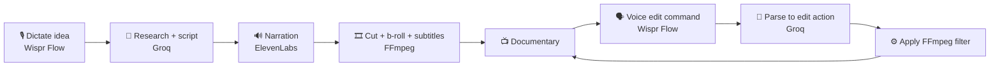

<div align="center">

# 🎬 Vidrush

### Dictate a documentary. Edit it by voice.

Speak a rough idea and get a full YouTube documentary with narration, cinematic b-roll and karaoke subtitles. Then direct the final cut by talking.

[**Live Demo**](YOUR_VIDRUSH_URL) · [**Demo Video**](YOUR_DEMO_VIDEO_URL) · [**Built by Anurag**](https://github.com/Anurag13075)


*Built for the Wispr Flow x WeMakeDevs Hackathon · Track: No Code for Every Other Role*

</div>

---

## The Problem

Making a documentary means researching, scripting, recording narration, sourcing b-roll, cutting, color grading and subtitling. That is days of work across several tools, and it needs real editing skill. Most people with a good story never get it published.

## The Solution

Vidrush turns the whole workflow into one voice-driven flow. You speak, it produces the video, and you refine it by speaking again. There is no timeline and no editing software.

> **"Make it warmer." "Speed up the intro." "Make the subtitles bigger."**
> Say it. Vidrush re-renders the video.

<!-- Add a GIF of the voice-edit moment here -->
<!--  -->

## How It Works



### 1. Generate

| Step | What happens | Tool |
|---|---|---|
| Dictate | Speak a rough, stream-of-consciousness idea | Wispr Flow |
| Research and script | The topic is researched and written into a documentary script | Groq |
| Narrate | The script becomes a voiceover | ElevenLabs |
| Cut | Narration, cinematic b-roll and karaoke-style subtitles are assembled into a video | FFmpeg |

### 2. Edit by voice

Once the video exists, you direct it by talking:

1. Wispr Flow turns your speech into text.
2. Groq parses the text into a structured edit command.
3. The command runs as an FFmpeg operation and the video re-renders.

```json
{ "action": "color_grade", "style": "warm" }
```

| You say | What changes |
|---|---|
| "Make it warmer" | Color grade is re-applied |
| "Speed up the intro" | The opening is retimed |
| "Make the subtitles bigger" | Caption style is updated |
| "Swap the second b-roll clip" | The clip is replaced |

When you are happy, download the final video.

## Features

- **Voice in, documentary out.** Messy dictation becomes a researched, scripted, narrated video.
- **Cinematic b-roll** layered under the narration.
- **Karaoke-style subtitles** that highlight words as they are spoken.
- **Voice-driven editing** for color grading, pacing, subtitles and clips.
- **One-click download** of the finished video.
- **No timeline, no editing skills required.**

## Tech Stack

| Layer | Tool |
|---|---|
| Voice input and voice edits | [Wispr Flow](https://wisprflow.ai) |
| Research, scripting, command parsing | [Groq](https://groq.com) |
| Narration | [ElevenLabs](https://elevenlabs.io) |
| Video cutting, color grading, subtitles | [FFmpeg](https://ffmpeg.org) |
| App | TypeScript |

## Getting Started

### Prerequisites

- Node.js 18 or later
- [FFmpeg](https://ffmpeg.org/download.html) installed and available on your `PATH`
- API keys for Groq and ElevenLabs
- [Wispr Flow](https://wisprflow.ai) for dictation

### Install

```bash
git clone YOUR_REPO_URL
cd vidrush
npm install
```

### Configure

Create a `.env` file in the project root:

```env
GROQ_API_KEY=your_groq_key
ELEVENLABS_API_KEY=your_elevenlabs_key
```

### Run

```bash
npm run dev
```

Open the app, click into the idea box, and start talking with Wispr Flow.

## Usage

1. **Dictate** your documentary idea with Wispr Flow.
2. **Generate** and wait for the script, narration and cut to finish.
3. **Direct** the video by dictating edit commands into the command box.
4. **Download** the final video.

## Why Voice

Voice is usually treated as a faster keyboard. Vidrush treats it as the entire interface, from the first idea to the last tweak. A creator never touches a timeline, which opens video production to people that editing tools have shut out.

## Roadmap

- [ ] More edit commands (transitions, music, aspect ratio)
- [ ] Undo and redo for voice edits
- [ ] Multiple visual styles and narrator voices
- [ ] Direct upload to YouTube

## Author

**Anurag** · solo full-stack and AI developer
[GitHub](https://github.com/Anurag13075) · [X](https://x.com/AnuragShar74342) · [Portfolio](https://anuragweb.site)

## Acknowledgements

Thanks to [Wispr Flow](https://wisprflow.ai) and [WeMakeDevs](https://www.wemakedevs.org) for the hackathon.

---

<div align="center">

**Think out loud. Get a documentary. Direct it with your voice.**

</div>
